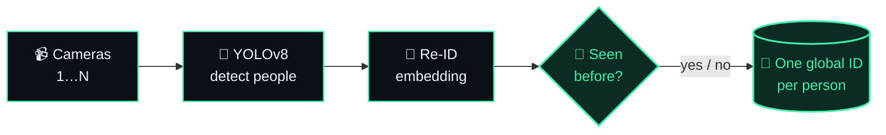

<p align="center">
  
</p>

<p align="center">
  <a href="https://karankatore01.github.io">
    
  </a>
</p>

<p align="center">
  <a href="https://karankatore01.github.io"></a>
  <a href="https://linkedin.com/in/karan-katore-3a3280243"></a>
  <a href="mailto:karankatore01@gmail.com"></a>
  <a href="https://www.kaggle.com/karankatore01"></a>
</p>

<p align="center">
  
</p>

---

### `> whoami`

```python
class KaranKatore:
    role      = "AI Engineer @ NymbleUp"
    based_in  = "Mumbai, India 🇮🇳"
    focus     = ["Computer Vision", "Multi-camera Tracking & Re-ID", "Generative AI", "RAG"]
    education = "B.Tech CSE · Sandip University · CGPA 8.68"

    def superpower(self):
        return "turning raw CCTV into answers: who, where, how many"
```

---

## 🏆 Flagship · [Multi-Camera Detection & Person Re-ID](https://github.com/karankatore01/multi_camera_detection)

> **The problem:** a person walks past five cameras — and every camera thinks it's a different person.
> **The fix:** detect everyone, describe each person by appearance, and give them **one identity across all cameras.**



<p>
  
  
  
  
  
  
  &nbsp;<a href="https://github.com/karankatore01/multi_camera_detection"></a>
</p>

---

## 🧪 More things I've built

<table>
  <tr>
    <td width="50%" valign="top">
      <h3>🧍 Global Identity Matching</h3>
      <i>"Is this the same person I saw on camera 3?"</i><br/><br/>
      Matches people across cameras with <b>FastReID</b> embeddings and similarity search, keeping a shared registry of global identities.
      <br/><br/>
        
      <br/><br/><a href="https://github.com/karankatore01/camera_detect"><b>→ code</b></a>
    </td>
    <td width="50%" valign="top">
      <h3>🎓 Real-Time Student Monitoring</h3>
      <i>"Who's confused right now — and who's cheating?"</i><br/><br/>
      Students' webcams stream to a <b>FastAPI</b> backend; a teacher dashboard shows live engagement, confusion and proctoring alerts with explainable CV logic.
      <br/><br/>
        
      <br/><br/><a href="https://github.com/karankatore01/student-monitoring-system"><b>→ code</b></a>
    </td>
  </tr>
  <tr>
    <td width="50%" valign="top">
      <h3>💬 RAG-Based AI Chatbot</h3>
      <i>"Answer from my documents, not from thin air."</i><br/><br/>
      Retrieval-augmented chatbot with <b>LangChain + FAISS</b>, served on Flask and AWS Lambda — <b>+30% response relevance</b> over plain retrieval.
      <br/><br/>
        
      <br/><br/><a href="https://github.com/karankatore01/Rag-Based-ChatBot"><b>→ code</b></a>
    </td>
    <td width="50%" valign="top">
      <h3>🧠 MBTI Personality Prediction</h3>
      <i>"Tell me how you write — I'll tell you who you are."</i><br/><br/>
      NLP model that reads a person's text and predicts which of the <b>16 MBTI personality types</b> they are, wrapped in a Flask web app.
      <br/><br/>
        
      <br/><br/><a href="https://github.com/karankatore01/MBTI-Personality-Prediction"><b>→ code</b></a>
    </td>
  </tr>
</table>

---

### 🛠️ Tech stack

<p align="center">
  <br/>
  
</p>

<p align="center">
  
  
  
  
  
  
  
  
  
  
</p>

---

<p align="center">
  <a href="https://karankatore01.github.io">
    
  </a>
</p>

<p align="center">
  
</p>
