  
  
  
  

 

  

<h2>🏆 Flagship project</h2>

> **The problem:** a person walks past five cameras — and every camera thinks it's a different person.
> **My fix:** detect everyone with YOLOv8, describe each person by appearance with a Re-ID model, and give them **one identity across every camera.** &nbsp;[→ view code](https://github.com/karankatore01/multi_camera_detection)

 

<h2>🧪 More things I've built</h2>

  
  

  
  

 

<h2>📈 Journey</h2>

  

  

